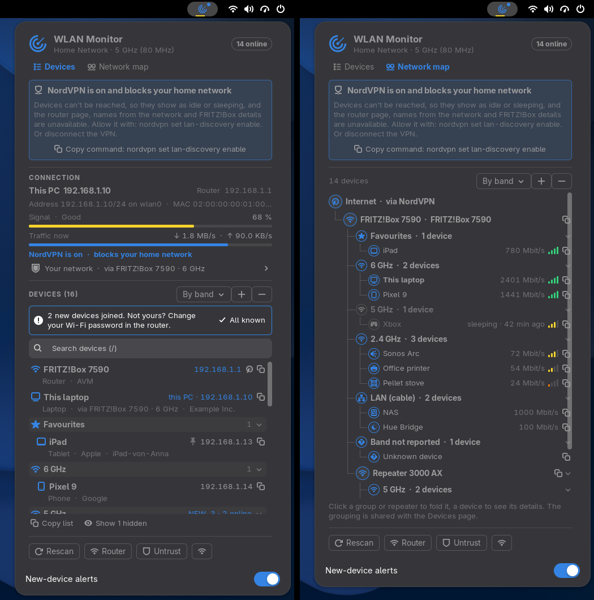

# WLAN Monitor for GNOME

**See who is on your Wi-Fi from the top bar, in plain words: every device with a type icon, name, maker and status, names you choose yourself, an alert when a new device joins, collapsible groups (by platform, type or Wi-Fi band), a network map as a tree, FRITZ!Box mesh details and VPN detection.**

WLAN Monitor is a GNOME Shell extension (GNOME 51) that discovers and lists devices on your local WLAN without root privileges or extra packages. It is the GNOME port of the Omarchy bar widget [WLAN Monitor](https://github.com/uBruckhaus/omarchy-wlan-monitor) and uses the same collector, so device names, pins and trusted networks are stored in the same place.



- **Top bar icon:** a radar. Dim while disconnected, green when connected, blue while a VPN is active, with a thin signal-quality line underneath coloured by level, and a dot when a new device joined. It pulses while the subnet is being scanned.
- **Signal in words:** **Excellent** (70 %+, green), **Good** (50 %+, yellow), **Fair** (30 %+, orange) and **Weak** (below 30 %, red). Hover the signal meter for dBm, channel and link speed.
- **Detail panel (left click):**
  - **Connection:** this PC's and the router's address, signal in words, and live download / upload. One summary line ("Your network · via FRITZ!Box 7590 · 6 GHz") opens the explanations and the FRITZ!Box login on click.
  - **Devices:** every device on the local subnet with an icon for its type (phone, tablet, computer, TV, speaker, printer, game console, camera, lighting, storage, appliance, smart-home device, router). Your router and this PC come first, then pinned devices.
  - **Readable automatic names** from mDNS / Zeroconf or the router's DNS, tidied up (`PHILIPS_EP8757_20_392985` becomes `Philips EP8757`).
  - **Click a device** for its details in plain words (status explained, maker, model, network name, IP, MAC) and actions: **Rename** (Enter saves, Esc cancels, an empty name restores the automatic one), **Pin to top**, **Hide** (**Show N hidden** lists them again), **Open web page** for the router and devices that offer one, and **It's mine** for new devices.
  - **New-device alerts (trusted networks):** a desktop notification and a **NEW** badge when a device joins that was never seen on this network before. **It's mine** or **All known** clears them. The **New-device alerts** switch at the bottom of the menu turns the notifications off.
  - **Groups:** the grouping button next to the device header (and on the network map) switches between **No groups**, **By platform**, **By type**, and with FRITZ!Box mesh details **By band** and **By access point**. Groups fold with a click; **+** / **−** open or fold all.
  - **Network map (second page):** Internet › router › your groups › devices, with repeaters as their own branches, link speed and signal bars per device. A click on a device opens it on the Devices page.
  - **Search:** with more than 12 devices a search field appears (press `/`).
  - **Copy IP / Copy list:** the copy icon copies a device's IP; **Copy list** copies all devices as a Markdown table.
  - **Rescan**, **Router** (your router's settings page), **Trust / Untrust** and a Wi-Fi button that opens GNOME Settings' Wi-Fi page.
- **Right click:** an immediate rescan.

English only.

## VPNs

While a VPN is active (NordVPN, WireGuard, Proton VPN, Mullvad, Tailscale, OpenVPN and other tunnel interfaces), the bar icon turns **blue**, the panel shows a line such as "NordVPN is on · home network reachable" under the traffic meter, and the network map labels the top node "Internet via NordVPN". Many VPNs block the home network: devices then look idle or asleep, and the router page, names from the network and FRITZ!Box details are unavailable. WLAN Monitor checks the router about every 30 s while a VPN is up (a TCP connect to ports 80, 53 or 443). If the router does not answer, the panel shows which VPN blocks the home network and how to allow it (for NordVPN: `nordvpn set lan-discovery enable`, with a button to copy the command). It also pauses its own scans and the FRITZ!Box reading until the network is reachable again.

## Trusted networks and scanning

Discovery is **passive** on every network by default: the kernel neighbor table, mDNS announcements and single reverse-DNS lookups for devices that are already visible. Nothing sweeps the subnet automatically, so the widget behaves well on hotel, café and office Wi-Fi. The only connections it makes there on its own are single TCP connect checks of the router's web interface (ports 80 and 443) and of web interfaces that devices advertise over mDNS (before a link to them is offered), the router check while a VPN is up (see above), the unauthenticated FRITZ!Box description, and an empty UDP datagram to the router's discard port (at most every 10 s, only through the monitored interface) when the kernel's entry for the router has aged out, so the trusted-network check keeps working when nothing else talks to the router (e.g. all traffic goes through a VPN). **Rescan** runs one full sweep on any network when you ask for it.

Click **Trust** in the panel to allow **active** scanning on the current network (identified by SSID and router MAC address, both seen at that moment and read again, together with the shared trust list, right before every automatic sweep or probe starts: while the router is not in the neighbour table, or after a disconnect, nothing is inherited from before):

- a full sweep every 2 minutes (and when you open the panel, if the last one is older than 30 s): paced ICMP echo to the local `/24` plus a reverse-DNS (PTR) query per address to the router, which also finds sleeping DHCP leases;
- every 15 s a unicast probe of the devices already known, so the online state stays accurate without broadcast ARP traffic.

**Rescan** (or right click) runs one active sweep on demand, on any network. Trusted networks are stored in `~/.config/ubruckhaus-wlan-monitor/trusted-networks.json` (directory `0700`, file `0600`), written only when you click Trust or Untrust.

### FRITZ!Box login

The login is optional and only offered when the router is a FRITZ!Box: its maker in the MAC address database says so, or, when the database does not know the router's maker, its public TR-064 description (asked once per router, on trusted networks only) names a FRITZ!Box model. Where to find the login:

- There is no fixed default user name. FRITZ!OS before 7.24 asks only for a password; leave the user name empty.
- FRITZ!OS 7.24 and newer: if you never created a user, an update created one named `fritz` plus four random digits (e.g. `fritz1234`). Log in at http://fritz.box and look under System › FRITZ!Box Users.
- Unless you changed it, the password is printed on the label on the bottom or back of the FRITZ!Box (4 to 6 lowercase letters followed by 4 digits).

You can also create a separate FRITZ!Box user with the right "FRITZ!Box settings" (System › FRITZ!Box Users) and keep "Allow access for applications" on (Home Network › Network › Network Settings).

- The user name and password go from the panel to the collector over its stdin pipe (never as command-line arguments) and are saved in `~/.config/ubruckhaus-wlan-monitor/fritzbox.json` (`0600`) only after a successful login. The password is never sent back to the panel; the saved user name is, so the form can offer it again when you reconnect.
- They are bound to that FRITZ!Box's MAC address and used only with the current gateway when its MAC matches. All FRITZ!Box connections leave only through the monitored network interface (`SO_BINDTODEVICE`), and the router's MAC is read from that interface's neighbour table, so a device with the same address on another network (e.g. Ethernet and Wi-Fi at once) never gets them. They go over TR-064 HTTPS (port 49443) with HTTP Digest authentication, so the password itself is never transmitted.
- Only one collector per user talks to the FRITZ!Box: the first to take `fritzbox-leader.lock` (this extension or an Omarchy widget on the same account) holds it while it runs, reads and saves the login and polls the mesh list, and publishes what it reads, never the password, in `fritzbox-state.json`. The others show that only while it is fresh and for the router they see themselves, and pass a login or Disconnect to it over a private Unix socket in `$XDG_RUNTIME_DIR/ubruckhaus-wlan-monitor/` (`0600`, peers checked with `SO_PEERCRED`). Disconnect drops the login at once and deletes `fritzbox.json` (or empties it if it cannot be deleted). When that collector ends, another one takes over within a few seconds.
- The saved login is shared with any other collector using the same folder (e.g. the Omarchy widget): before every refresh the collector reads it again, so a **Disconnect** elsewhere stops it too, and a login saved elsewhere is used from then on.
- The FRITZ!Box certificate is self-signed; its SHA-256 fingerprint is pinned at login. If it changes, nothing is sent and the panel asks you to connect again.
- A login is bound to the router it was typed for. The collector gives the network it sees a fresh id whenever the gateway (address, MAC or interface) changes; the form remembers the id it was opened with and sends it with the login, and the collector refuses the login unless that id is still current when the login arrives, so a login typed on one router is never queued for another, even if the panel has not caught up with a change yet. When the network changes while the form is open, the form closes and the typed password and user name are cleared; Cancel and Escape clear only the password, and a user name left from another network is cleared when the form is opened again. If the network changes before it is sent, or while it is being sent, it is dropped and never sent to the new router: right before the password-derived response goes out, the gateway is checked again (no change reported since the login was typed, and the kernel still has that router's MAC at the address). Nothing from such a login is saved; the panel asks you to connect again.
- Reads: `X_AVM-DE_GetMeshListPath` and the mesh list it points to, every 30 s while the panel is open and every 5 minutes otherwise. Replies are size-limited (64 KiB SOAP, 2 MiB mesh list), time-limited (4 s) and every field is validated and sanitized. Nothing is ever changed on the FRITZ!Box.

Device names, pins and hidden flags are stored per network (router MAC + SSID) in `~/.config/ubruckhaus-wlan-monitor/devices.json` (`0600`). On trusted networks the MAC addresses seen there are remembered too, so new devices can be recognised; on other networks only devices you rename, pin or hide are written. The file is bounded (32 networks, 512 devices each) and read with the same checks as the trust list (no symlinks or other special files, owned by you, at most 8 MiB, which the largest valid store fits in, every field validated, times only within a sane range). Each change re-reads the file under a shared lock, applies only that change and writes it atomically, and the collector reads it again when it changed, so it never undoes a change made by the Omarchy widget or another collector on the same account (without the lock within 2 s, a change is shown but not written).

Optional environment variables for GNOME Shell (set them for your session): `WLAN_MONITOR_INTERVAL` (seconds between snapshots while the panel is open, default 3), `WLAN_MONITOR_INTERVAL_CLOSED` (default 6) and `WLAN_MONITOR_FULL_SCAN_EVERY` (full sweep interval on trusted networks, default 120, minimum 30).

## Install

Requires GNOME Shell 51 and `python3` (standard library only). `avahi-browse` (for names from mDNS) and `iw` are used when installed.

```sh
tools/build.sh
gnome-extensions install --force dist/wlan-monitor@ubruckhaus.github.io.shell-extension.zip
```

Log out and back in, then `gnome-extensions enable wlan-monitor@ubruckhaus.github.io`.

## How it works

A collector (`scripts/wlan-monitor.py`) runs while the extension is enabled and streams one JSON snapshot every 3 s while the panel is open (6 s while closed). The extension sends it commands over stdin (`rescan`, `open` / `closed`, `trust` / `untrust`, `known_all`, `fritz_logout`, and one-line JSON: `rename`, `pin`, `hide`, `known`, `alerts`, `view`, `fritz_login`). JSON commands are limited to 1 KiB, every field must have the expected type (a command with a wrong type is ignored as a whole, and a command that fails is dropped without stopping the collector), device commands need a valid MAC of a device currently listed on this network, and names are cut to 40 printable characters without `<`, `>` or `&`.

- **Light on the system:** routes, signal level and traffic come from `/proc`; `iw` and `ip addr` run only every 12 / 30 s (or when the network changes). All external commands run as fixed argv lists with bounded output and timeouts.
- **Unprivileged local discovery:**
  - Reads the kernel neighbor table (`ip -4 neigh show`). On trusted networks, sends paced unprivileged ICMP echo probes (see above) so online devices show up there.
  - Queries the router's reverse DNS (`PTR` records) over bounded UDP sockets. Replies are only accepted from the router's address and port 53 with a random, outstanding query ID. The router's local domain (e.g. `fritz.box`, `speedport.ip`, `home.arpa`, or one learned from the PTR answers / `resolv.conf`) is removed from names.
  - Reads mDNS / Zeroconf service announcements via `avahi-browse` when available, for human-friendly device names (e.g. TV, soundbar, bridge), model strings and web interfaces.
  - Maps MAC prefixes against the system's local IEEE OUI database (`/usr/lib/udev/hwdb.d/20-OUI.hwdb` or `/usr/share/hwdata/oui.txt`).
- **Network changes:** everything learned (devices, names, caches) is cleared when the interface, gateway, subnet, SSID or router MAC changes, so devices from your home network never appear on another one.
- **New-device notifications** use `notify-send` with a fixed argv; device names in them are sanitized like everywhere else and at most three are listed.
- **Sanitized untrusted text:** All SSIDs, hostnames, mDNS strings and vendor names are stripped of `<`, `>`, `&` and control characters before output, and the panel shows them only as plain text (St labels, no markup).
- **Safe web links:** web UI URLs are built only from the device's private IPv4 address inside the local subnet, a numeric port and a plain path (`[A-Za-z0-9._~/-]`, no `..`). Advertised services are offered only after a TCP connect check succeeds. The panel checks the URL shape again and opens it in your default browser through GIO, with no shell.

## Differences from the Omarchy widget

- GNOME Shell extension instead of a Quickshell bar widget; English only, no language setting and no plugin information page.
- **New-device alerts** is a switch in the menu (the Omarchy widget had it on its settings page).
- Copying uses GNOME's clipboard instead of `wl-copy`; web pages open in the default browser through GIO; the Wi-Fi button opens GNOME Settings.
- GNOME's top bar has no tooltips, so the explanations of the signal and traffic meters show when you hover them, the device type is in each row's second line and its status explained in the expanded details.

## Remove

```sh
gnome-extensions uninstall wlan-monitor@ubruckhaus.github.io
```

The extension creates no services. The only files outside its folder are the trusted network list, the device names and view settings, the optional FRITZ!Box login, and the small coordination files `fritzbox-leader.lock`, `trusted-networks.lock`, `devices.lock` (empty lock files) and `fritzbox-state.json` (what the FRITZ!Box collector last read, without the password) in `~/.config/ubruckhaus-wlan-monitor/` (shared with the Omarchy widget, all `0600`). Before any of them is read, the directory itself is checked (a real directory, not a symlink, owned by you, not writable by group or others), and each file is opened relative to it without following symlinks and refused unless it is a regular file owned by you that group and others cannot write; `fritzbox.json`, which holds the password, is refused if group or others have any access to it at all. Delete that directory to remove them.

## Development

```sh
python3 wlan-monitor@ubruckhaus.github.io/scripts/wlan-monitor.py --once | python3 -m json.tool
python3 -m unittest discover -s tests
tools/headless-test.sh panel      # isolated headless GNOME Shell on this machine's network (passive)
tools/headless-test.sh fixture    # the same with tools/fixtures/mesh.json: mesh, repeater, VPN, new devices
```

Screenshots go to `dist/screenshots/`.

Licensed under [MIT](LICENSE).
